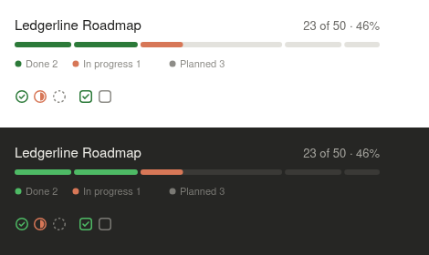
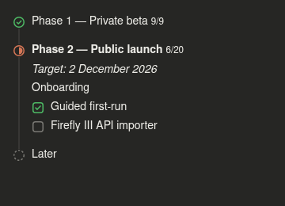

# Roadmap pane for Claude Code

A Claude Code mod that shows your project's `ROADMAP.md` as a live timeline in a side pane: overall progress, one row per phase, and tasks you can tick off without leaving the session.





## Install

At the prompt of a terminal `claude` session:

```
/plugin install roadmap --marketplace LeoBessin/claude-roadmap-mod
```

Answer `y` to add the marketplace, then pick a scope (user scope loads it in every session). Once installed it also loads in Claude Code sessions started by the desktop app.

## Use

- Open a project that has a `ROADMAP.md`: the pane opens by itself.
- `/roadmap` opens the pane; `/roadmap path/to/file.md` points it at another file.
- Click a phase to open or close it, click a task to tick it in the file.
- Filter with All, Open and Done; ↻ reloads.

The pane follows the file as it changes, including edits Claude makes.

## Roadmap format

```markdown
# Project roadmap

One line about where the project is heading.

## Phase 1 — Foundations (in progress)

Short note about the phase.

### Platform
- [x] Set up the repository
- [ ] Ship the first milestone
  - [ ] A nested task

## Later

- Ideas without checkboxes are shown but not counted
```

- `#` is the title, `##` headings are phases, `###` headings are groups.
- `- [ ]` and `- [x]` are tasks; plain bullets are notes.
- A phase is done, in progress or planned from its tasks, or from a marker in its heading: ✅, 🚧, `(done)`, `(in progress)`.

Without a roadmap, the pane offers to create one.

## Surfaces

On the desktop app the header, bar and icons are SVG in Claude Code's colors, following the system's light or dark scheme. In the terminal the same layout is drawn with text.

## Develop

```bash
claude plugin validate .
```

```bash
claude plugin test .
```

To run a working copy instead of the installed one, name its folder in `CLAUDE_CODE_PLUGIN_DIRS` in the `env` block of `~/.claude/settings.json`.

## License

MIT
